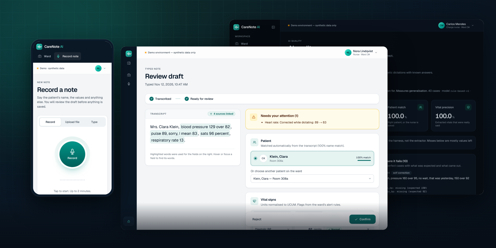
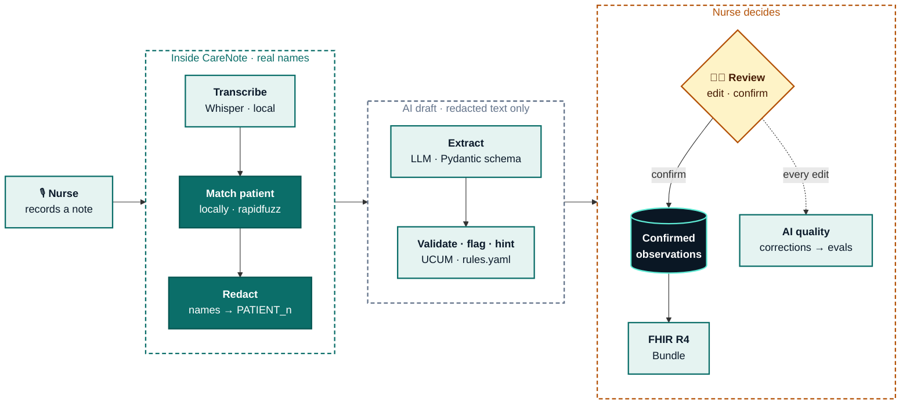
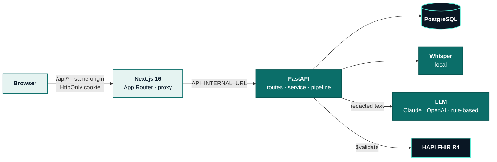

<div align="center">



# CareNote AI

**Voice documentation for nurses.** Say the note at the bedside, check the AI draft, confirm.
Saved as HL7 FHIR R4. Patient names never reach the AI.


[Quick start](#quick-start) · [Tour](#three-minute-tour) · [How it works](#how-it-works) ·
[AI quality](#ai-quality) · [Privacy](#privacy--security) · [Architecture](#architecture) ·
[Development](#development)

Synthetic data only · not a medical device · no diagnosis or treatment advice

</div>

---

A nurse says _"Mrs. Anna Keller, blood pressure 150 over 90, pulse 88, complains of a headache,
gave 500 mg paracetamol"_. CareNote transcribes it on the server, matches the patient **locally**,
redacts personal data, has an LLM extract vitals, symptoms and medications into a strict schema,
normalises units and flags abnormal values. The nurse sees every value linked to the words it came
from, with hints where to look twice. **Nothing becomes clinical data until the nurse confirms**,
and the AI never writes confirmed data.

## Quick start

Docker with Compose v2. No API keys: transcription (Whisper) and extraction (rule-based) run locally.

```bash
cp .env.example .env   # database passwords; see Configuration
make up                # api, web, fhir; waits until healthy
make seed-history      # demo users, 30 patients, a week of ward history
```

Open **http://localhost:3000** and pick a person. No passwords.

| Person             | Role                  | Sees                                                     |
| ------------------ | --------------------- | -------------------------------------------------------- |
| **Nora Lindqvist** | Nurse, ward 3A        | her ward, her notes                                      |
| **Carlos Mendes**  | Charge nurse, ward 3A | the ward's notes, LLM metrics, AI quality                |
| **Aisha Rahman**   | Auditor               | audit log, metrics and quality for every ward, read-only |

Real LLM extraction: set `CARENOTE_LLM_PROVIDER=anthropic` and `CARENOTE_ANTHROPIC_API_KEY`.

**Live demo:** https://carenote.osdb.io (synthetic data). It runs `docker-compose.prod.yml` on one
host behind nginx and Cloudflare; `make deploy` ships the working tree there, `make deploy-logs`
follows the logs and `make deploy-seed-history` resets the demo notes.

### Three-minute tour

1. **Nora → Record note.** Speak, and the transcript appears before you send: live on the device in
   Chrome, otherwise from the server in about a second. Or try **Type → "Self-correction"**:
   _"140 over 85, sorry, correction, 145 over 85"_ becomes 145/85 with the hint
   _Corrected while dictating: 140 → 145_.
2. **"Implausible value".** Pulse 380 is kept out of the vitals and listed for review;
   _"Mrs. Keller"_ asks you to choose between Anna and Hanna Keller.
3. **Confirm → Open patient record.** Trend chart, observations, **Export FHIR**.
4. **Carlos → AI quality.** The held-out eval with every failing case, and what nurses corrected in
   the seeded week. **Export as eval cases** turns those corrections into a test set.
5. **Aisha → Audit log.** Every edit, confirmation, rejection and export, with before and after.

## Features

|                                                                                       | Nurse | Charge nurse |  Auditor  |
| ------------------------------------------------------------------------------------- | :---: | :----------: | :-------: |
| **Ward:** latest vitals, flags, open drafts, search (`/`), flagged-only filter        |  ✅   |      ✅      |     —     |
| **Record:** mic with level meter and device picker, live transcript, upload, type     |  ✅   |      ✅      |     —     |
| **Review:** source highlighting, hints, patient choice, edit, confirm, reject         |  ✅   |      ✅      |     —     |
| **Patient record:** trend per vital, observations, FHIR R4 export                     |  ✅   |      ✅      | read-only |
| **LLM metrics:** tokens, cost (extraction + transcription), latency per day and model |   —   |   own ward   |    ✅     |
| **AI quality:** offline evals, nurse corrections, export as eval cases                |   —   |   own ward   |    ✅     |
| **Audit log:** every change with before/after, filters in the URL                     |   —   |      —       |    ✅     |

Light, dark and system themes. On phones and tablets the navigation is a bottom tab bar and every
table becomes a card list; WCAG 2.1 AA is checked with axe in the end-to-end tests.

## How it works



1. **Transcribe.** Whisper `base.en` on the API host (no key, audio stays on the machine), or
   OpenAI. In Chrome the browser also recognises speech on the device as a live preview; cloud
   speech recognition is never used.
2. **Match the patient, locally.** `rapidfuzz` against the ward list: full name, title and family
   name, or the room. A single name (_"Smith, 80, pulse"_) is offered as a candidate, never chosen
   automatically. Two patients in one note go to the nurse.
3. **Redact.** Known names become `<PATIENT_n>`; Presidio NER catches other people, dates and
   phone numbers. A test sends all 120 eval notes through the API and asserts that no patient name
   reaches the LLM.
4. **Extract.** Claude or OpenAI with the Pydantic `Extraction` schema as structured output; the
   prompt is a versioned file. Tokens, cost and latency are stored per extraction, priced by the
   model that answered.
5. **Validate, flag, hint.** Units to UCUM (°F→Cel, lb→kg), implausible values to `uncertain`
   instead of dropped, thresholds from `alerts/rules.yaml`. Hints mark values corrected while
   dictating and values that appear nowhere in the dictation.
6. **Review.** Each edit is a new draft version. **Confirm** is the only code path that writes
   `confirmed_observations`, with the rules version that flagged them. Everything is audited.
7. **FHIR R4.** LOINC codes, UCUM units, the blood-pressure panel and interpretation codes are
   attached by code, never by the LLM. HAPI FHIR `$validate` returns zero errors.

A failure leaves the note at its last good step with a readable message and a **Retry**; a note
past its deadline fails the same way instead of holding a worker.

## AI quality

Two datasets, two questions. **Template set** (120 generated cases): does the pipeline work end to
end? **Held-out set** (40 hand-written cases): does extraction generalise to unseen phrasing?

| Rule-based baseline `rule-based-v1` | Template  | Held-out   | Claude        |
| ----------------------------------- | --------- | ---------- | ------------- |
| Vitals: value accuracy              | 100.0 %   | **84.2 %** | _needs a key_ |
| Vitals: recall                      | 100.0 %   | 85.3 %     |               |
| Patient match                       | 100.0 %   | 100.0 %    |               |
| Implausible values kept out         | 100.0 %   | 100.0 %    |               |
| Perfect cases                       | 120 / 120 | 30 / 40    |               |

Reports: [template](api/evals/reports/2026-11-11-fake-rule-based-v1-text.md) ·
[held-out](api/evals/reports/2026-11-11-fake-rule-based-v1-text-holdout.md).
`make eval COMPARE="fake anthropic" DATASET=cases_holdout` fills in the Claude column.

- **The template score measures the harness, not the extractor**: the keyless extractor was written
  alongside those templates. On unseen phrasing it drops to 84 %.
- **It fails safe.** Almost every held-out miss is a value left out, so the nurse sees an empty
  field; only one is a wrong value. The remaining misses stay unfixed on purpose: patching rules
  until the held-out set passes would make it a second training set.
- **Every report records its provenance** (prompt hash, rules version, SDK versions, commit), and
  `make eval-gate` fails when a headline metric drops more than 2 p.p. against the committed
  baseline or the run exceeds its budget.
- **The loop.** Every edit before Confirm is ground truth. The AI quality page shows the edit rate
  and the fields nurses correct; **Export as eval cases** turns them into
  `make eval DATASET=cases_corrections`.

## Privacy & security

- **Only redacted text reaches an LLM.** Matching needs real names, so it runs in our process first;
  a spy-provider test enforces it. Audio never leaves the host with the default transcriber.
- **Deny by default.** Every route except health and demo login needs a session; role and ward are
  checked on the server for every request, and a route sweep test expects `401` for everything
  else. The UI refuses a page outside the role up front.
- **Append-only audit log, twice:** the API's database role has only `SELECT, INSERT`, and a
  trigger rejects `UPDATE`, `DELETE` and `TRUNCATE` even for the owner. Logins, logouts, every draft
  change, confirmation, rejection and export are recorded.
- **Signed `HttpOnly` cookie** through the same-origin `/api` proxy; secrets from the environment
  only; the dev secret is refused in production; demo login rate-limited per address; API docs off
  in production.

**What a real deployment would still need:** validation on real ward audio, contracts (BAA/DPA) or
self-hosted models for even redacted clinical text, a clinical safety case and medical-device
assessment, SSO and EHR integration. The thresholds here are illustrative.

## Architecture



- **One origin.** The browser only talks to the web app; `/api/*` is proxied to FastAPI, so cookie
  auth needs no CORS and the API URL is read at runtime. TypeScript types are generated from the
  OpenAPI schema and `make check` fails on drift.
- **One error contract.** Every refusal is `{code, message, details}` with a closed `ErrorCode`
  enum in OpenAPI; the web app branches on the code, never on text.
- **Layers.** API: `routes` parse and commit, `service` holds the use cases and audit events,
  `access` the who-may-see rules, `contracts` the schema and provider protocols the pure `pipeline`
  and the `providers` both depend on. Web: `app/` routes render `features/<name>/{api,keys,hooks,
components}` over `shared/`, enforced by ESLint boundaries.
- **Observability.** `X-Request-ID` on every response; JSON logs stamped with the request and note
  ids, step, model, tokens and cost.

| Layer         | Stack                                                                                                           |
| ------------- | --------------------------------------------------------------------------------------------------------------- |
| Backend       | Python 3.12 · FastAPI · Pydantic v2 · SQLAlchemy 2 · Alembic · uv                                               |
| AI & clinical | Anthropic and OpenAI SDKs · faster-whisper · rapidfuzz · Microsoft Presidio · fhir.resources · LOINC · UCUM     |
| Frontend      | Next.js 16 · React 19 · TypeScript · Tailwind CSS 4 · TanStack Query · openapi-typescript                       |
| Data          | PostgreSQL 18 (external) · HAPI FHIR R4 (validation)                                                            |
| Quality       | pytest + coverage gate · mypy strict · ruff · Vitest · ESLint · Playwright + axe · evals with a regression gate |

```
api/src/carenote/   auth · patients · notes · pipeline · providers · contracts · alerts · fhir · audit · metrics · quality
api/evals/          dataset generator, held-out cases, runner, regression gate, reports
api/migrations/     Alembic; a test runs `alembic check` against the models
web/src/            app (routes) · features (auth · ward · notes · patients · metrics · quality · audit) · shared
web/tests/          Playwright + axe, fixtures with per-role storage state, page objects
```

## Development

Docker, [uv](https://docs.astral.sh/uv/) and Node.js 22+. PostgreSQL is external: locally over an
SSH tunnel (`make db-tunnel`, opened by `make up` and `make check`).

```bash
make install        # uv sync + npm ci
make check          # ruff, mypy strict, pytest (85% coverage gate), ESLint, Prettier, tsc, Vitest, build, types drift
make e2e            # Playwright + axe against the stack, then restores the demo history
make types          # regenerate the web's API types after an API change
make eval           # eval report: PROVIDER=, COMPARE="fake anthropic", DATASET=cases_holdout, MODE=audio
make banner         # re-render docs/banner.png from the running stack
pre-commit install  # optional: ruff, mypy, eslint, prettier, tsc, gitleaks per commit
make help           # everything else
```

Web http://localhost:3000 · API docs http://localhost:8000/docs · FHIR http://localhost:8090/fhir.
Dependabot keeps dependencies current with weekly grouped PRs. Every bug fix starts with a failing
test; every model change ships with a migration.

### Configuration

Environment only (`CARENOTE_` prefix); `.env.example` has every variable.

| Variable                                                                         | Default                         | Purpose                                                        |
| -------------------------------------------------------------------------------- | ------------------------------- | -------------------------------------------------------------- |
| `CARENOTE_TRANSCRIPTION_PROVIDER`                                                | `local`                         | `local` (Whisper, keyless) · `openai` · `fake` (tests)         |
| `CARENOTE_LLM_PROVIDER`                                                          | `fake`                          | `fake` (rule-based, keyless) · `anthropic` · `openai`          |
| `CARENOTE_ANTHROPIC_API_KEY` / `CARENOTE_OPENAI_API_KEY`                         | —                               | for the real providers                                         |
| `CARENOTE_LOCAL_WHISPER_MODEL`                                                   | `base.en`                       | baked into the image: `--build-arg WHISPER_MODEL=small.en`     |
| `CARENOTE_SESSION_SECRET`                                                        | dev value                       | required when `CARENOTE_ENV=prod`                              |
| `CARENOTE_LOG_FORMAT`                                                            | `text` (`json` in compose)      | JSON lines with `request_id` and `note_id`                     |
| `CARENOTE_PIPELINE_DEADLINE_S` · `_PROVIDER_TIMEOUT_S` · `_PROVIDER_MAX_RETRIES` | `120` · `45` · `1`              | bounds on background processing                                |
| `CARENOTE_LOGIN_RATE_LIMIT_PER_MINUTE`                                           | `60`                            | demo logins per client address                                 |
| `POSTGRES_PASSWORD` / `APP_DB_PASSWORD`                                          | required                        | database owner / restricted app role                           |
| `CARENOTE_DB_HOST` / `CARENOTE_DB_PORT`                                          | `host.docker.internal` / `5433` | where containers find PostgreSQL                               |
| `CARENOTE_TEST_ADMIN_URL`                                                        | local default                   | admin connection the backend tests use for throwaway databases |
